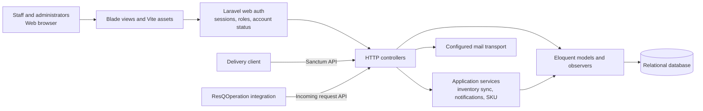

# TrackingAid Project Documentation

This document combines the current source-based architecture overview with planning templates. Timeline dates and research findings are intentionally left open until the team supplies approved dates and evidence.

## Architecture overview

TrackingAid is implemented as a monolithic Laravel application. The browser UI, application logic, web authentication, API endpoints, and database access live in one deployable codebase. Blade renders the web pages, Laravel controllers and services implement request handling and business rules, Eloquent models access the relational database, and Vite builds frontend assets.

### Main modules

- **Frontend:** Blade templates under `resources/views`; shared layouts and components; CSS and JavaScript built with Vite.
- **Authentication and access:** Laravel session authentication for browser users, Sanctum tokens for API clients, role middleware, and account status checks.
- **Inventory:** Items, inventory, stock batches, storage locations, and SKU/inventory services. Admins manage locations; deactivation is blocked while current inventory or available stock uses a location. Batch quantities support receiving and expiry tracking.
- **Requests and fulfillment:** Request review and decisions, releases/deliveries, and returns. Stock-sensitive operations use transactions; current release and return records retain source/receiving storage locations and responsible users where captured.
- **Reports:** Inventory, request, movement, and distribution reports with CSV/PDF or external API paths where implemented.
- **Accountability:** Model observers and account history features record selected changes.
- **Persistence and delivery:** Migrations define relational data; seeders provide demo data. Email setup/reset flows depend on the deployment mail transport.

### Request flow and boundaries

1. A browser or API client calls a Laravel route.
2. Middleware checks authentication, account state, and role where required.
3. A controller validates input and applies business logic through services and Eloquent.
4. Stock changes are persisted with the relevant workflow records.
5. The application returns a Blade page or JSON response; configured mail may send account messages.

This describes the current code structure. It does not imply a separate frontend or microservice deployment, nor does it establish that external integrations or production email are configured in a particular environment.

## Project timeline template

Fill dates, owners, and progress with the project team. The sequence is a planning outline, not a record of completed work.

| Phase | Work and deliverable | Owner | Start | End | Duration | Progress/status |
| --- | --- | --- | --- | --- | --- | --- |
| Requirements and workflow discovery | Confirm users, warehouse/location rules, inventory and fulfillment workflows; signed requirements | TBD | TBD | TBD | TBD | Not recorded |
| Research and problem validation | Interviews/observations, evidence log, problem statement and baseline measures | TBD | TBD | TBD | TBD | Not recorded |
| Analysis and design | Use cases, data model, architecture, UI and integration design review | TBD | TBD | TBD | TBD | Not recorded |
| Implementation | Prioritized modules, migrations, interfaces, integration work | TBD | TBD | TBD | TBD | Not recorded |
| Testing and debugging | Automated suite, manual QA, defect fixes and retest evidence | TBD | TBD | TBD | TBD | Not recorded |
| Documentation | User/deployment guides, test record, final project documentation | TBD | TBD | TBD | TBD | Not recorded |
| Final evaluation and presentation | Acceptance review, evaluation evidence, presentation and handover | TBD | TBD | TBD | TBD | Not recorded |

Update the table during project planning. For progress, record a dated percentage or a clear status and link the evidence/deliverable. Do not backfill completion dates without team records.

## Research validation plan and evidence log

### Purpose

Validate the operational problem and whether TrackingAid's inventory, request, release, return, storage-location, and reporting workflows address it. The project team should confirm the target organizations, participant roles, sample, consent process, and evaluation criteria before collecting evidence.

### Suggested methods

| Method | Evidence to capture | Status |
| --- | --- | --- |
| Stakeholder interviews | Role (or anonymized code), date, consent, questions, notes, coded themes | Not recorded; conduct with approval |
| Workflow observation | Process steps, handoffs, artifacts, timing, exceptions; remove personal data | Not recorded; conduct with approval |
| Document review | Approved forms/registers, definitions, revision/date, fields compared | Not recorded; source documents needed |
| Prototype/system evaluation | Task, participant role, completion, errors, time, feedback, test build | Not recorded; schedule after protocol approval |

### Interview prompts

- How are stock items, quantities, batches, expiry dates, and storage locations recorded today?
- How are requests reviewed, approved or rejected, released, delivered, and returned?
- Where do delays, duplicate entry, missing information, or quantity mismatches occur? Can you describe a recent example without identifying affected people?
- Which reports or decisions depend on these records, and how do staff verify the totals?
- What permissions, audit records, connectivity, training, and data-retention requirements apply?
- What measurable change would make the system useful, and how could it be checked?

### Evidence log (complete with actual research)

| Evidence ID | Date | Method/source | Participant/source code | Observation or finding | Supporting artifact | Limitation / follow-up |
| --- | --- | --- | --- | --- | --- | --- |
| TBD | TBD | TBD | TBD | No finding recorded yet | TBD | Collect and review evidence |

### Baseline and evaluation measures

Agree definitions and collection methods before collecting values. Enter only measured values with source references.

| Measure | Operational definition | Baseline/source/date | Target and rationale | Post-use result/source/date |
| --- | --- | --- | --- | --- |
| Inventory record variance | Difference between system quantity and independently counted quantity for defined scope | TBD | TBD | TBD |
| Request processing time | Elapsed time from complete submission to recorded decision; define exclusions | TBD | TBD | TBD |
| Fulfillment reconciliation | Difference between released/returned totals and approved source records | TBD | TBD | TBD |
| User task completion | Share of participants completing agreed tasks without assistance; define sample/tasks | TBD | TBD | TBD |

Do not claim that these measures improved until comparable baseline and post-use evidence has been collected and reviewed. Protect participant and operational data; anonymize notes and follow the institution's consent and retention requirements.
